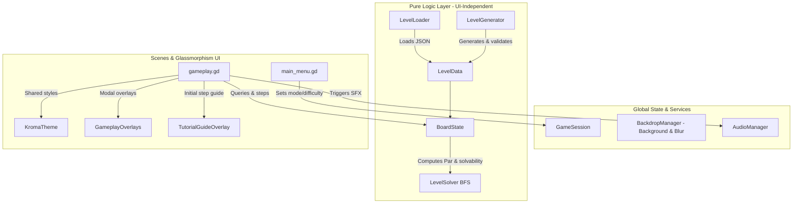

<div align="center">

# KROMA · v2.0


**INERTIA · SYNTHESIS · SPACE**

*Minimalist logic puzzle game built around discrete inertia, chromatic synthesis, and topological mutation.*

[Overview](#overview) •
[Rules & Algebra](#mechanics-and-chromatic-algebra) •
[Modes & Challenge](#campaign-simulation-and-perfect-streak) •
[Controls](#multiplatform-controls) •
[Architecture](#technical-architecture) •
[Repository](#repository-structure) •
[Credits](#studio-credits)

</div>

---

## Overview

**KROMA** is a 2D spatial logic puzzle game built in **Godot Engine 4**. Players operate on discrete orthogonal grids (`5×5` to `7×7`) where blocks have zero friction and slide continuously until colliding with walls, board boundaries, or other pieces.

The design articulates three core principles:
1. **Discrete inertia:** Every move projects the active block in a straight line until it hits a rigid obstacle.
2. **Deterministic chromatic synthesis:** Colliding two primary colors merges them into the corresponding secondary color.
3. **Progressive topological mutation:** Upon locking into a matching receptor, a block becomes `LOCKED` and turns into permanent board geometry, creating new 90° pivot and braking points.

---

## Mechanics and Chromatic Algebra

### 1. Color Synthesis and Universal Glyphs
To ensure full accessibility for color-vision deficiencies, every chromatic channel is uniquely paired with a geometric vector glyph ([`glyph.gd`](scripts/view/glyph.gd)):

| Primaries | | Resulting Secondary | Role |
| :---: | :---: | :---: | :--- |
| 🔴 **Red** (`Circle`) | + 🔵 **Blue** (`Square`) | 🟣 **Purple** (`Diamond`) | Primary synthesis |
| 🔵 **Blue** (`Square`) | + 🟡 **Yellow** (`Triangle`) | 🟢 **Green** (`Cross`) | Primary synthesis |
| 🟡 **Yellow** (`Triangle`) | + 🔴 **Red** (`Circle`) | 🟠 **Orange** (`Hexagon`) | Primary synthesis |

> **Convenience rule:** Secondary blocks are stable terminal states; colliding against another secondary or a primary acts as a rigid stop with no reaction.

### 2. Structural Voids (`voids`) and Defeat Detection
Cells marked with `⤫` have no floor: any block crossing them is immediately destroyed. After every move, `BoardState` mathematically evaluates whether the sector has become unsolvable:
* **Numeric insufficiency:** Fewer active blocks remain than pending receptors.
* **Chromatic incompatibility:** Remaining primary blocks can no longer synthesize the required target colors.
* **Kinematic deadlock:** No active block has any valid move in any cardinal direction.

Whenever a deadlock occurs, the simulation displays an unsolvable-state overlay with instant recovery via **Undo** or **Restart**.

---

## Campaign, Simulation, and Perfect Streak

### Curated Campaign (Sectors 01 – 04)
1. **Sector 01 — Vector Inertia (`5×5`):** Introduction to frictionless sliding and wall braking.
2. **Sector 02 — Pivot and Brake (`6×6`):** Switching between blocks to use active pieces as physical stops.
3. **Sector 03 — Spectrum Link (`5×5`):** Chromatic synthesis between primaries to activate secondary goals.
4. **Sector 04 — Structural Fault (`6×6`):** Navigating around void pits and mandatory perimeter rebounds.

The opening sectors feature a **dual interactive tutorial**: a contextual pill that confirms each mechanic upon execution, plus a minimalist visual guide (pulsing rounded frame + animated chevrons) driven by `LevelSolver`.

### Endless Procedural Simulation by Difficulty
After completing the campaign (or directly from the main menu), [`LevelGenerator`](scripts/levels/level_generator.gd) builds BFS-verified boards across three presets:

| Difficulty | Grid | Par Moves | Walls | Voids | Mechanics |
| :--- | :---: | :---: | :---: | :---: | :--- |
| **Easy** | `5×5` | `3 – 5` | `8%` | `0` | Direct routes · 1 receptor |
| **Normal** | `6×6` | `5 – 9` | `14%` | `1 – 3` | Support blocks · `15%` dual receptors |
| **Hard** | `7×7` | `8 – 14` | `20%` | `3 – 6` | High wall density · `75%` dual receptors |

Every 3 cleared sectors in a single run, the generator progressively scales minimum step complexity.

### Optimal Par (BFS), Ranks, and Perfect Streak
On level load, `LevelSolver` computes the **Optimal Par** (`MOVES XX / PAR YY`):
* ★★★ **Rank S (Optimal):** `Moves <= Par`
* ★★☆ **Rank A (Efficient):** `Moves <= Par + 3`
* ★☆☆ **Rank B (Cleared):** `Moves > Par + 3`

The **Perfect Streak** tracks consecutive sectors cleared in **Rank S**, without using **Undo**, without **Restart**, and without falling into **voids**. The all-time record is persisted locally in `user://save.cfg` via [`GameSession`](scripts/autoload/game_session.gd).

---

## Multiplatform Controls

Designed for **Desktop / Web** and **Mobile**:

| Action | Keyboard (PC / Web) | Touch / Mouse (Mobile / Web) |
| :--- | :---: | :--- |
| **Move block** | `W` `A` `S` `D` / `↑` `←` `↓` `→` | **Swipe** across the screen |
| **Switch block** | `Tab` / `Space` | **Tap** directly on a block or `⇄ CAMBIAR` button |
| **Undo move** | `Z` | `↶ DESHACER` button on bottom dock |
| **Restart sector** | `R` | `↺ REINICIAR` button on bottom dock |
| **Pause / Menu** | `ESC` | `\|\| PAUSA` button at top-right |

---

## Technical Architecture



* **Unified Glassmorphism Aesthetic:** [`KromaTheme`](scripts/view/kroma_theme.gd) centralizes the charcoal glass palette, specular-bevel cards, reactive buttons, and orthogonal wall auto-tiling; [`BackdropManager`](scripts/autoload/backdrop_manager.gd) keeps a continuous blurred grid and level-reactive ambient halo across scenes using `frosted_blur.gdshader`.
* **Strict Decoupling:** `BoardState` and `LevelSolver` run on pure logic without inheriting from `Node`, ensuring deterministic simulation.

---

## Repository Structure

```
kroma-puzzle/
├── assets/
│   ├── audio/                      # Parametric sound effects (.wav)
│   ├── branding/                   # Modular SVG pieces of the KR[O]MA logo
│   └── shaders/                    # Frosted glass blur shader (frosted_blur.gdshader)
├── data/
│   ├── levels/                     # Campaign sector definitions in JSON (01 to 04)
│   └── solutions/                  # Canonical BFS-verified solutions
├── docs/                           # Technical documentation and management report
├── scenes/
│   ├── main_menu.tscn / .gd        # Title screen, demo side rails, and modals
│   └── gameplay.tscn / .gd         # Main gameplay controller and board view
├── scripts/
│   ├── autoload/                   # AudioManager, GameSession, BackdropManager
│   ├── board/                      # BoardState (logic FSM) and LevelSolver (BFS)
│   ├── controllers/                # Input and history helper controllers
│   ├── levels/                     # LevelData, LevelLoader, LevelGenerator
│   ├── tests/                      # Automated headless unit test suite
│   └── view/                       # KromaTheme, Glyph, GameplayOverlays, TutorialGuideOverlay
├── export_presets.cfg              # Export presets
├── icon.svg                        # KROMA vector icon
├── project.godot                   # Godot 4 project configuration
└── README.md                       # Main documentation
```

---

## Installation, Running, and Tests

1. Clone the repository and open `project.godot` in **Godot Engine 4.x**:
   ```bash
   git clone https://github.com/bytoledo/kroma.git
   cd kroma
   ```
2. Press `F5` in the editor to launch from the title screen (`main_menu.tscn`).
3. Run the headless logic unit tests:
   ```bash
   godot --headless --path . --script res://scripts/tests/test_board_state.gd
   godot --headless --path . --script res://scripts/tests/test_solver.gd
   ```

---

## Studio Credits

Developed by **KROMA Dev Studio**:

* **Toledo (`bytoledo`):**
  * Decoupled gameplay architecture ([`gameplay.gd`](scenes/gameplay.gd)), session state ([`GameSession`](scripts/autoload/game_session.gd)), and record persistence.
  * Difficulty-scaled procedural generator ([`level_generator.gd`](scripts/levels/level_generator.gd)), BFS Optimal Par, and mathematical defeat detection in [`BoardState`](scripts/board/board_state.gd).
  * Glassmorphism visual system ([`KromaTheme`](scripts/view/kroma_theme.gd)), main menu ([`main_menu.gd`](scenes/main_menu.gd)), continuous backdrop ([`BackdropManager`](scripts/autoload/backdrop_manager.gd)), SVG branding, and wall auto-tiling.
  * Multiplatform support (touch swipe/tap controls, mobile dock, pause overlay) and interactive visual tutorial ([`TutorialGuideOverlay`](scripts/view/tutorial_guide_overlay.gd)).
  * Reactive audio manager ([`AudioManager`](scripts/autoload/audio_manager.gd)) and kinetic feedback (*squash & stretch* / *micro-bump*).
* **Christian (`Cvelazquez3`):**
  * Base implementation of the JSON loader and validator ([`LevelLoader`](scripts/levels/level_loader.gd)).
  * Initial board state abstraction and algorithmic BFS verifier ([`LevelSolver`](scripts/board/level_solver.gd)).
* **Carlos (`Carcamp016`):**
  * Base input subsystem and command buffering architecture.
  * Undo history pipeline (`history_stack`) and initial HUD / level sequencing layout.
* **Ian (`imartinez31`):**
  * Design and specification of the universal accessibility geometric glyph system ([`Glyph`](scripts/view/glyph.gd)).
  * Kinematic modeling of structural voids (`voids`).

---

## License

Distributed under the **MIT License**.
