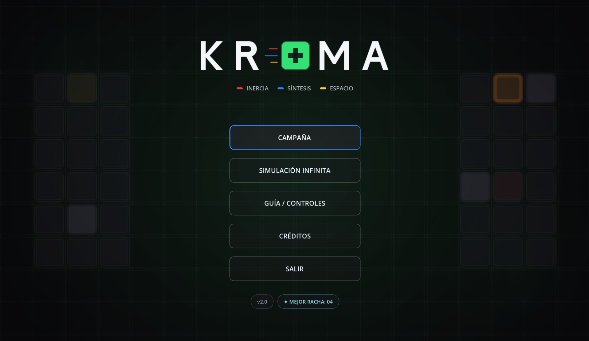
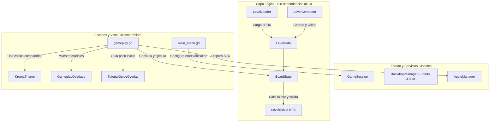

<div align="center">



# KROMA · v2.0


**INERCIA · SÍNTESIS · ESPACIO**

*Videojuego minimalista de puzles lógicos basado en inercia discreta, síntesis cromática y mutación topológica.*

[Visión General](#visión-general) •
[Reglas y Álgebra](#reglas-mecánicas-y-álgebra-cromática) •
[Modos y Reto](#campaña-simulación-y-racha-perfecta) •
[Controles](#controles-multiplataforma) •
[Arquitectura](#arquitectura-técnica) •
[Estructura](#estructura-del-repositorio) •
[Créditos](#créditos-del-estudio)

</div>

---

## Visión General

**KROMA** es un videojuego de lógica espacial 2D desarrollado en **Godot Engine 4**. El jugador opera sobre cuadrículas ortogonales discretas (`5×5` a `7×7`) donde los bloques carecen de fricción y se deslizan de forma continua hasta colisionar con muros, bordes u otras piezas.

El diseño combina tres pilares:
1. **Inercia discreta:** Cada movimiento proyecta el bloque en línea recta hasta encontrar un obstáculo rígido.
2. **Síntesis cromática determinista:** Colisionar dos colores primarios los fusiona en el color secundario correspondiente.
3. **Mutación topológica progresiva:** Al encajar en su receptor, el bloque se bloquea (`LOCKED`) y pasa a formar parte de la geometría fija del tablero, habilitando nuevos puntos de apoyo y giros a 90°.

---

## Reglas Mecánicas y Álgebra Cromática

### 1. Síntesis de Colores y Glifos Universales
Para garantizar accesibilidad total ante daltonismo o discromatopsia, cada color está acoplado de forma unívoca a un glifo geométrico vectorial ([`glyph.gd`](scripts/view/glyph.gd)):

| Primarios | | Secundario Resultante | Símbolo |
| :---: | :---: | :---: | :--- |
| 🔴 **Rojo** (`Círculo`) | + 🔵 **Azul** (`Cuadrado`) | 🟣 **Púrpura** (`Rombo`) | Fusión primaria |
| 🔵 **Azul** (`Cuadrado`) | + 🟡 **Amarillo** (`Triángulo`) | 🟢 **Verde** (`Cruz`) | Fusión primaria |
| 🟡 **Amarillo** (`Triángulo`) | + 🔴 **Rojo** (`Círculo`) | 🟠 **Naranja** (`Hexágono`) | Fusión primaria |

> **Regla de conveniencia:** Los bloques secundarios son estados finales estables; al chocar contra otro secundario o un primario actúan como tope físico sin reaccionar.

### 2. Abismos Estructurales (`voids`) y Detección de Derrota
Las celdas marcadas con `⤫` carecen de sustrato: cualquier bloque que pase sobre ellas queda eliminado. Tras cada turno, `BoardState` evalúa automáticamente si el sector se volvió irresoluble:
* **Insuficiencia numérica:** Quedan menos bloques activos que receptores pendientes.
* **Incompatibilidad cromática:** Los colores disponibles ya no pueden sintetizar los objetivos restantes.
* **Deadlock cinemático:** Ningún bloque activo tiene movimientos válidos.

Ante cualquier bloqueo, la simulación muestra el aviso de estado irresoluble con recuperación inmediata mediante **Deshacer** o **Reiniciar**.

---

## Campaña, Simulación y Racha Perfecta

### Campaña Curada (Sectores 01 – 04)
1. **Sector 01 — Inercia de Vector (`5×5`):** Introducción al desplazamiento sin fricción y frenado contra muros.
2. **Sector 02 — Pivote y Freno (`6×6`):** Alternancia de bloques para usar piezas activas como apoyo y freno.
3. **Sector 03 — Enlace de Espectro (`5×5`):** Síntesis cromática entre primarios para activar metas secundarias.
4. **Sector 04 — Falla Estructural (`6×6`):** Navegación alrededor de abismos y rebotes perimetrales.

Los primeros sectores integran un **tutorial interactivo dual**: un *pill* contextual que confirma cada mecánica al ejecutarla y una guía visual minimalista (marco redondeado + chevrones animados) calculada por `LevelSolver`.

### Simulación Infinita por Dificultad
Tras completar la campaña (o directamente desde el menú principal), [`LevelGenerator`](scripts/levels/level_generator.gd) produce tableros validados previamente por BFS con tres perfiles:

| Dificultad | Tamaño | Pasos (Par) | Muros | Abismos | Mecánica |
| :--- | :---: | :---: | :---: | :---: | :--- |
| **Fácil** | `5×5` | `3 – 5` | `8%` | `0` | Rutas directas · 1 receptor |
| **Normal** | `6×6` | `5 – 9` | `14%` | `1 – 3` | Bloques de apoyo · `15%` 2 acoples |
| **Difícil** | `7×7` | `8 – 14` | `20%` | `3 – 6` | Alta densidad · `75%` 2 acoples |

Cada 3 sectores superados en una misma corrida, el generador incrementa progresivamente la complejidad mínima.

### Par Óptimo (BFS), Rangos y Racha Perfecta
Al cargar cada nivel, `LevelSolver` calcula el **Par Óptimo** (`PASOS XX / PAR YY`):
* ★★★ **Rango S (Óptimo):** `Pasos <= Par`
* ★★☆ **Rango A (Eficiente):** `Pasos <= Par + 3`
* ★☆☆ **Rango B (Completado):** `Pasos > Par + 3`

La **Racha Perfecta** contabiliza sectores consecutivos resueltos en **Rango S**, sin usar **Deshacer**, sin **Reiniciar** y sin caer en **abismos**. El récord histórico se guarda localmente en `user://save.cfg` mediante [`GameSession`](scripts/autoload/game_session.gd).

---

## Controles Multiplataforma

Diseñado para **PC / Web** y **Teléfono**:

| Acción | Teclado (PC / Web) | Táctil / Mouse (Teléfono / Web) |
| :--- | :---: | :--- |
| **Mover bloque** | `W` `A` `S` `D` / `↑` `←` `↓` `→` | **Swipe** (deslizar) sobre la pantalla |
| **Cambiar bloque** | `Tab` / `Espacio` | **Tap** directo sobre el bloque o botón `⇄ CAMBIAR` |
| **Deshacer (Undo)** | `Z` | Botón `↶ DESHACER` en dock inferior |
| **Reiniciar sector** | `R` | Botón `↺ REINICIAR` en dock inferior |
| **Pausar / Menú** | `ESC` | Botón `\|\| PAUSA` arriba a la derecha |

---

## Arquitectura Técnica



* **Estética unificada (*Glassmorphism*):** [`KromaTheme`](scripts/view/kroma_theme.gd) centraliza la paleta gris carbón, tarjetas translúcidas con bisel especular, botones reactivos y el *auto-tiling* ortogonal de muros; [`BackdropManager`](scripts/autoload/backdrop_manager.gd) mantiene el fondo desenfocado continuo entre menú y partida con `frosted_blur.gdshader`.
* **Desacoplamiento estricto:** `BoardState` y `LevelSolver` corren sobre lógica pura sin heredar de `Node`, garantizando determinismo absoluto.

---

## Estructura del Repositorio

```
kroma-puzzle/
├── assets/
│   ├── audio/                      # Efectos de sonido (.wav)
│   ├── branding/                   # Piezas SVG modulares del imagotipo KR[O]MA
│   └── shaders/                    # Shader de vidrio esmerilado (frosted_blur.gdshader)
├── data/
│   ├── levels/                     # Sectores de campaña en JSON (01 a 04)
│   └── solutions/                  # Soluciones canónicas verificadas por BFS
├── docs/                           # Documentación técnica y reporte de gestión
├── scenes/
│   ├── main_menu.tscn / .gd        # Pantalla de inicio, rieles demo y modales
│   └── gameplay.tscn / .gd         # Controlador principal de partida y tablero
├── scripts/
│   ├── autoload/                   # AudioManager, GameSession, BackdropManager
│   ├── board/                      # BoardState (FSM lógica) y LevelSolver (BFS)
│   ├── controllers/                # Controladores auxiliares de entrada e historial
│   ├── levels/                     # LevelData, LevelLoader, LevelGenerator
│   ├── tests/                      # Pruebas unitarias automatizadas
│   └── view/                       # KromaTheme, Glyph, GameplayOverlays, TutorialGuideOverlay
├── export_presets.cfg              # Preajustes de exportación
├── icon.svg                        # Isotipo vectorial de KROMA
├── project.godot                   # Configuración central de Godot 4
└── README.md                       # Documentación principal
```

---

## Instalación, Ejecución y Pruebas

1. Clona el repositorio y abre `project.godot` en **Godot Engine 4.x**:
   ```bash
   git clone https://github.com/Cvelazquez3/Kroma.git
   cd Kroma
   ```
2. Presiona `F5` dentro del editor para iniciar desde la pantalla de título (`main_menu.tscn`).
3. Para correr las pruebas unitarias de lógica en modo *headless*:
   ```bash
   godot --headless --path . --script res://scripts/tests/test_board_state.gd
   godot --headless --path . --script res://scripts/tests/test_solver.gd
   ```

---

## Créditos del Estudio

Desarrollado por **KROMA Dev Studio**:

* **Toledo (`bytoledo`):**
  * Arquitectura desacoplada de partida ([`gameplay.gd`](scenes/gameplay.gd)), sistema de sesión ([`GameSession`](scripts/autoload/game_session.gd)) y persistencia de récords.
  * Motor de generación procedural por dificultades ([`level_generator.gd`](scripts/levels/level_generator.gd)), Par Óptimo BFS y detección matemática de derrota en [`BoardState`](scripts/board/board_state.gd).
  * Identidad visual *glassmorphism* ([`KromaTheme`](scripts/view/kroma_theme.gd)), menú principal ([`main_menu.gd`](scenes/main_menu.gd)), fondo continuo ([`BackdropManager`](scripts/autoload/backdrop_manager.gd)), branding SVG y *auto-tiling* de muros.
  * Soporte multiplataforma (controles táctiles *swipe/tap*, dock móvil, menú de pausa) y tutorial visual interactivo ([`TutorialGuideOverlay`](scripts/view/tutorial_guide_overlay.gd)).
  * Gestor de audio reactivo ([`AudioManager`](scripts/autoload/audio_manager.gd)) y retroalimentación cinemática (*squash & stretch* / *micro-bump*).
* **Christian (`Cvelazquez3`):**
  * Implementación base del cargador y validador JSON ([`LevelLoader`](scripts/levels/level_loader.gd)).
  * Abstracción lógica inicial del estado del tablero y desarrollo del verificador algorítmico BFS ([`LevelSolver`](scripts/board/level_solver.gd)).
* **Carlos (`Carcamp016`):**
  * Arquitectura base del subsistema de entradas y amortiguación de comandos.
  * Pipeline de historial para reversión temporal (`history_stack`) y maquetación inicial de HUD y secuenciación de niveles.
* **Ian (`imartinez31`):**
  * Diseño y especificación del sistema de glifos geométricos de accesibilidad universal ([`Glyph`](scripts/view/glyph.gd)).
  * Modelado de la interacción cinemática de abismos estructurales (`voids`).

---

## Licencia

Distribuido bajo la **Licencia MIT**.
