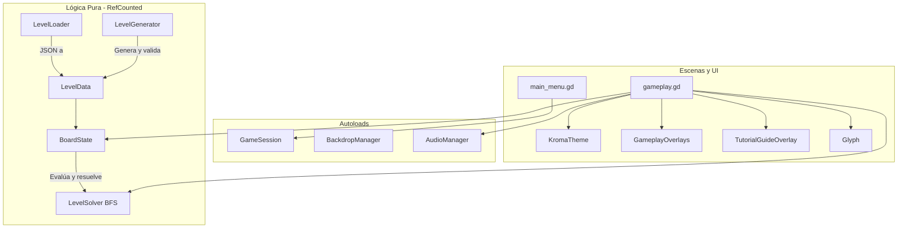

# Technical Design Document (TDD) — Kroma (v2.0)

> **Motor:** Godot Engine 4.7 (`mobile` renderer, `canvas_items` stretch mode, `expand` aspect)  
> **Lenguaje:** GDScript  
> **Plataformas configuradas:** Windows Desktop (`export_presets.cfg`), Web / HTML5 WASM (`export_presets.cfg`)  
> **Escena principal:** `res://scenes/main_menu.tscn`

---

## 1. Visión Arquitectónica

La arquitectura de **Kroma** separa estrictamente la **lógica matemática del tablero** de la **capa de presentación en Godot**:

1. **Autoloads (Servicios Globales):**
   * `AudioManager` ([audio_manager.gd](../scripts/autoload/audio_manager.gd))
   * `GameSession` ([game_session.gd](../scripts/autoload/game_session.gd))
   * `BackdropManager` ([backdrop_manager.gd](../scripts/autoload/backdrop_manager.gd))
2. **Capa Lógica Pura (`RefCounted`, sin nodos ni señales):**
   * `LevelData` ([level_data.gd](../scripts/levels/level_data.gd))
   * `LevelLoader` ([level_loader.gd](../scripts/levels/level_loader.gd))
   * `BoardState` ([board_state.gd](../scripts/board/board_state.gd))
   * `LevelSolver` ([level_solver.gd](../scripts/board/level_solver.gd))
   * `LevelGenerator` ([level_generator.gd](../scripts/levels/level_generator.gd))
3. **Capa de Escenas, Vista y Control:**
   * `main_menu.gd` / `main_menu.tscn`
   * `gameplay.gd` / `gameplay.tscn` ([gameplay.gd](../scenes/gameplay.gd))
   * `KromaTheme` ([kroma_theme.gd](../scripts/view/kroma_theme.gd))
   * `Glyph` ([glyph.gd](../scripts/view/glyph.gd))
   * `GameplayOverlays` ([gameplay_overlays.gd](../scripts/view/gameplay_overlays.gd))
   * `TutorialGuideOverlay` ([tutorial_guide_overlay.gd](../scripts/view/tutorial_guide_overlay.gd))

---

## 2. Modelo de Datos y Formato de Niveles

### 2.1 Convención de Coordenadas
* Matriz bidimensional `_grid[x][y]`, donde `x` es la columna (`0` a la izquierda) e `y` es la fila (`0` arriba), coincidiendo con el espacio 2D de Godot.
* Vectores cardinales unitarios: `Vector2i.UP`, `Vector2i.DOWN`, `Vector2i.LEFT`, `Vector2i.RIGHT`.

### 2.2 `LevelData` y `LevelLoader`
* **Formato JSON (v1):** Documentado en [formato_nivel.md](formato_nivel.md).
* **Validaciones en `LevelLoader.load_from_dict()`:**
  * `version == 1` (`FORMAT_VERSION`).
  * Dimensiones entre `MIN_SIZE = 5` y `MAX_SIZE = 8`.
  * Colores válidos: primarios (`red`, `blue`, `yellow`) y secundarios (`purple`, `green`, `orange`).
  * Cero solapamientos entre `walls`, `voids`, `blocks` y `receptors`.
  * Identificadores únicos por bloque, mínimo 1 bloque y 1 receptor, y nunca más receptores que bloques.
* **Niveles incluidos:** `data/levels/level_01.json` a `level_04.json` (y `level_fusion_test.json`), junto con soluciones verificadas en `data/solutions/level_01_solution.json` a `level_03_solution.json`.

---

## 3. Núcleo Lógico (`BoardState`)

`BoardState` encapsula el estado determinista de una partida sin dependencias de escena.

### 3.1 Estructuras Internas
* `enum Cell { EMPTY = 0, WALL = 1, VOID = 2, BLOCK = 3, RECEPTOR = 4, LOCKED = 5 }`
* `enum MoveResult { OK = 0, BLOCKED = 1, FELL = 2, SNAPPED = 3, VICTORY = 4, NOT_FOUND = 5 }`
* `_grid: Array` (`Array[Array[int]]` de tamaño `width × height`).
* `_blocks: Dictionary` mapeando `id (String) → { "pos": Vector2i, "color": String, "locked": bool }`.
* `_receptors: Array` de `{ "pos": Vector2i, "color": String }`.

### 3.2 Resolución de Movimiento (`apply_move`)
`apply_move(block_id: String, dir: Vector2i, out_path: Array = []) -> MoveResult` ejecuta un *raycast* discreto en bucle `while true`:
1. Calcula `candidate = current + dir`.
2. Si está fuera de límites (`not _in_bounds(candidate)`), frena (`break`).
3. Si `Cell.VOID`: limpia origen, elimina el bloque de `_blocks`, registra `candidate` en `out_path` y retorna `MoveResult.FELL`.
4. Si `Cell.RECEPTOR`:
   * Color distinto: frena en celda previa (`break`).
   * Color coincidente: marca `Cell.LOCKED`, fija `locked = true`, y retorna `VICTORY` si `_all_receptors_filled()`, o `SNAPPED` en caso contrario.
5. Si `Cell.WALL` o `Cell.LOCKED`: frena (`break`).
6. Si `Cell.BLOCK`: consulta `MERGE_TABLE` con `moving_color + "+" + target_color`.
   * Si existe fusión válida (`red+blue → purple`, `blue+yellow → green`, `yellow+red → orange` y simétricas): elimina el bloque objetivo, actualiza el color del bloque en movimiento, avanza a `candidate` y continúa el bucle (`continue`, conservando inercia).
   * Si no existe fusión (incompatibles o secundarios): frena en celda previa (`break`).
7. Si `Cell.EMPTY`: avanza a `candidate`, registra en `out_path` y continúa.

### 3.3 Snapshots, Undo y Feedforward
* `snapshot() -> Dictionary` y `restore(snap: Dictionary)`: realizan copia profunda de `_grid`, `_blocks` y `_receptors`.
* En `gameplay.gd`, `history_stack` almacena snapshots previos a cada movimiento válido para Undo ilimitado, e `initial_snapshot` permite reinicio instantáneo en `O(W·H)`.
* `preview_move(block_id, dir, out_path) -> Vector2i`: simula la trayectoria completa sin mutar estado (usado internamente por `is_defeated()` y disponible para feedforward visual).

### 3.4 Detección de Estado Irresoluble (`is_defeated`)
Tras cada movimiento sin victoria, `BoardState.is_defeated() -> bool` evalúa en orden:
1. **Insuficiencia numérica:** `active_block_ids().size() < total_remaining`.
2. **Incompatibilidad cromática:** Calcula el déficit de cada color secundario (`deficit_purple`, `deficit_green`, `deficit_orange`) y verifica que los bloques primarios disponibles cubran los receptores primarios más las fusiones obligatorias (`needed_red`, `needed_blue`, `needed_yellow`).
3. **Deadlock cinemático:** Comprueba mediante `preview_move()` si al menos un bloque activo tiene un destino distinto a su origen en alguna de las 4 direcciones cardinales.

---

## 4. Solver BFS y Generación Procedural

### 4.1 `LevelSolver` (Breadth-First Search)
* **Método principal:** `LevelSolver.solve(level: LevelData, max_states: int = 200_000) -> Dictionary`.
* **Clave de estado (`_state_key`):** serializa posiciones/colores de bloques activos y receptores ocupados para evitar re-explorar estados equivalentes en `visited: Dictionary`.
* **Exploración:** En cada estado expandido, prueba `active_block_ids × 4 direcciones`. Al alcanzar `MoveResult.VICTORY`, reconstruye la secuencia mínima de movimientos (`Array[{ "block": String, "dir": String }]`), garantizando el **Par Óptimo** exacto.

### 4.2 `LevelGenerator`
* **Presets (`DIFFICULTY_PRESETS`):**
  * `EASY (0)`: `5×5`, `3–5` pasos, `wall_density = 0.08`, `0` abismos, `extra_block_chance = 0.0`, `multi_receptor_chance = 0.0`.
  * `NORMAL (1)`: `6×6`, `5–9` pasos, `wall_density = 0.14`, `1–3` abismos, `extra_block_chance = 0.50`, `multi_receptor_chance = 0.15`.
  * `HARD (2)`: `7×7`, `8–14` pasos, `wall_density = 0.20`, `3–6` abismos, `extra_block_chance = 0.70`, `multi_receptor_chance = 0.75`.
* **Escalado progresivo:** `generate_for_difficulty(difficulty, run_index, max_attempts = 350)` suma `+1` al rango de pasos cada 3 sectores superados (`clampi(..., 0, 3)`) e incrementa `multi_receptor_chance` en `+0.08` por escalón en `NORMAL`/`HARD`, con fallback a los parámetros base si no halla candidato.
* **Validación:** Cada layout candidato se somete a `solve_bfs(candidate, max_steps)` y solo se acepta si `solution.size()` está dentro de `[min_steps, max_steps]`.

---

## 5. Capa de Presentación, Audio y Persistencia

### 5.1 Estética *Glassmorphism* y Accesibilidad
* **`BackdropManager`:** Autoload con `CanvasLayer` en capa `-10` (base oscura, retícula ortogonal y halo ambiental) y capa `-8` con `frosted_blur.gdshader` (`blur_radius = 5.0`), manteniendo continuidad visual entre menú y partida.
* **`KromaTheme`:** Centraliza `COLOR_MAP`, tipografía (`SystemFont`), estilos `StyleBoxFlat` para celdas, bloques, receptores y tarjetas translúcidas, y utilidades de compatibilidad Web (`KromaTheme.is_web()`, `KromaTheme.sym()`).
* **`Glyph`:** `Node2D` que dibuja en `_draw()` la geometría de alto contraste asociada a cada color (`circle`, `square`, `triangle`, `diamond`, `cross`, `hexagon`).

### 5.2 Control de Partida y Entrada (`gameplay.gd`)
* **Entrada multiplataforma:**
  * Teclado: acciones `move_up`, `move_down`, `move_left`, `move_right` (flechas y `WASD`), `undo_move` (`Ctrl+Z` / `Z`), `restart_level` (`R`), `Tab`/`Espacio` (cambiar bloque), `ESC` (pausa).
  * Táctil / Mouse: detección de *tap* para seleccionar bloque y *swipe* con umbral `SWIPE_THRESHOLD = 32.0` px para dirección cardinal.
* **Modales (`GameplayOverlays`):** Renderizados en `CanvasLayer` (`layer = 128`) con desenfoque de fondo para **Victoria** (cálculo de Rango `S`/`A`/`B` y estado de Racha Perfecta), **Derrota** y **Pausa**.
* **Tutorial (`TutorialGuideOverlay`):** Utiliza la solución óptima de `LevelSolver` para resaltar el bloque y dirección sugeridos en los primeros sectores.

### 5.3 Audio (`AudioManager`)
* Opera con `process_mode = Node.PROCESS_MODE_ALWAYS` y un *pool* de `POOL_SIZE = 6` nodos `AudioStreamPlayer` sobre el bus `"Master"`.
* Precarga 12 efectos `.wav` (`slide`, `bump`, `merge`, `snap`, `void`, `undo`, `ui_hover`, `ui_click`, `ui_back`, `victory_1..3`) y aplica variación sutil de tono (`randf_range(0.96, 1.04)`) y *fade out* opcional por `Tween`.

### 5.4 Persistencia (`GameSession`)
* Almacena estado de sesión (`mode`, `difficulty`, `perfect_streak`, `best_streak`).
* Persiste `best_streak` en `user://save.cfg` mediante `ConfigFile` (`[records] best_streak`).

---

## 6. Pruebas y Exportación

### 6.1 Suite de Pruebas (`scripts/tests/`)
El proyecto incluye scripts de verificación unitaria y funcional desacoplados:
* [test_board_state.gd](../scripts/tests/test_board_state.gd): Movimiento inercial, fusión cromática, frenos, abismos, `preview_move()`, `snapshot()`/`restore()` e `is_defeated()` (insuficiencia, incompatibilidad y deadlock).
* [test_solver.gd](../scripts/tests/test_solver.gd): Resolución óptima BFS sobre niveles de prueba.
* [test_level_loader.gd](../scripts/tests/test_level_loader.gd): Validación de esquema JSON y detección de errores de formato.
* [test_history_controller.gd](../scripts/tests/test_history_controller.gd): Pila de Undo y reinicio.

### 6.2 Presets de Exportación (`export_presets.cfg`)
* **Windows Desktop:** Preset configurado para ejecutable nativo Windows.
* **Web:** Preset HTML5/WASM con adaptaciones de símbolos Unicode vía `KromaTheme.sym()` para compatibilidad de fuentes en navegador.
